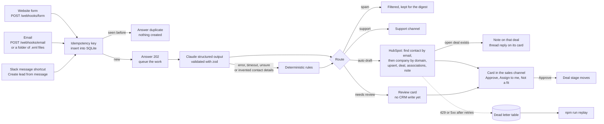

# Lead to Deal Copilot

Inbound leads from a web form, email or Slack become clean, deduplicated HubSpot deals, and a person approves them in Slack with one click.

[](https://github.com/ruan-grobler/lead-to-deal-copilot/actions/workflows/ci.yml)


[](LICENSE)

**The result.** 25 inbound messages became 15 Slack cards that each need one click. Through a HubSpot storm of 12 rate limit responses and 5 AI failures, **0 leads were lost and 0 duplicate deals were created**. Measured in the saved demo run, [`docs/demo-output.txt`](docs/demo-output.txt).


<sub>Two real cards from `npm run demo`, rendered from the Block Kit JSON the app posted to the mocked Slack API ([`slack-lead-cards.blocks.json`](docs/images/slack-lead-cards.blocks.json)) and captured with Playwright. The left lead was dead lettered in the 429 storm and posted after the replay.</sub>

## Quickstart

Needs Node 22.18 or newer. No accounts or keys: Slack, HubSpot and Claude are mocked in-process.

```bash
npm install
npm run demo
npm test
```

`npm run demo` replays 25 synthetic leads end to end and prints the report. `npm start` runs the real server in mock mode on `http://127.0.0.1:3000` with `/health`, `/webhooks/form` and `/webhooks/email`.

All data in this repo is synthetic. Northwind Managed IT is a fictional IT services firm in Cape Town. Every person, company, email address (`example.com`) and phone number (`+27 00 ...`) is invented.

## The business problem

A small B2B services firm gets leads in three places: the website form, the shared inbox and Slack, where salespeople paste leads from events and calls.

Someone has to read each one, decide if it is real, check the CRM for an existing contact, retype it into HubSpot and tell the team. The same person writes in twice. Spam gets typed in. A lead that arrives on Friday afternoon waits until Monday. When HubSpot rate limits a script, leads quietly go missing.

## Before, after and the number

| | |
|---|---|
| **Before** (estimate, not measured) | About 6 minutes per lead: 2 to read and triage, 1 to search HubSpot for duplicates, 2 to retype contact, company and deal, 1 to tell the team in Slack. For the 25 messages in the demo that is about 2.5 hours, spam and duplicates included. |
| **After** (measured in the demo run) | 25 inbound messages became 15 Slack cards that each need one click. The other 10 needed no sales decision: 3 replays were blocked, 4 spam messages were filtered, 2 follow ups were merged into open deals as notes, and 1 support request went to the support channel. Nothing was retyped. |
| **The number** | **0 leads lost and 0 duplicate deals**, through a HubSpot storm of 12 rate limit (429) responses, 5 AI failures and a malformed email. |

Source: [`docs/demo-output.txt`](docs/demo-output.txt), the saved output of `npm run demo`.

## How it works



A scheduler posts a threaded reminder on any card nobody touched for 2 hours, and a digest to the sales channel at 08:00 Africa/Johannesburg.

## What the demo covers

The 25 messages include clean leads from all three sources, a very high value lead (R2.4m a year, flagged and the sales lead mentioned), the same form delivered twice, the same email delivered twice, the same Slack message captured twice, a colleague from a company that already has an open deal, a follow up email from an existing contact, a contact already in HubSpot, junk, SEO spam, phishing, a prompt injection attempt, a support request, a malformed email with a broken From header and MIME boundary, and a HubSpot storm of 12 rate limit responses.

The demo then clicks the Slack buttons through the real Bolt app, runs the dead letter replay, the reminder sweep and the 08:00 digest, and checks its own results. Highlights from the saved run:

```text
  Replays blocked by idempotency key     3  (form retry, email redelivery, Slack shortcut clicked twice)
  Deduplicated against HubSpot           3  (2 by contact email, 1 by company domain)
  AI fallback used                       5  (timeout 1, ungrounded 1, api error 1, low confidence 1, invalid output 1)
  HubSpot 429 responses served           12
  Dead lettered                          2
  Replayed from dead letter              2  (2 succeeded, 0 failed)
  Duplicate deals                        0
  Leads lost                             0
  Processing latency p50 / p95           13 ms / 318 ms  (pipeline time per unique lead, first pass)

  [PASS] Every scenario ended as expected               25 of 25
  [PASS] No duplicate deals                             11 deals for 11 drafted leads, 0 contacts with two open deals
  [PASS] Digest at 08:00 Africa/Johannesburg, once      07:59 skipped, 08:00 posted, rerun skipped
```

The latencies are measured against local mocks, so they show the pipeline's own overhead and the cost of retries, not real network or model time.

## How it fails safely

- **Idempotency.** Every source message gets a key: the form provider's submission id, the email `Message-ID`, or the Slack workspace, channel and message timestamp (a hash of the payload when there is no id). The key is a unique column in SQLite. A replay answers `200 duplicate` and creates nothing.
- **Persist first, then answer.** Webhooks store the lead, answer `202` and process it on a queue, so a sender never waits on Claude or HubSpot.
- **Retries with backoff and jitter.** One retry runner wraps every HubSpot, Slack and Claude call. It retries 429, 5xx and network errors with exponential backoff and full jitter, honours `Retry-After`, and never retries a 4xx. The SDKs' own retries are switched off so attempts do not multiply.
- **Checkpoints.** Contact, company, deal, note and Slack card ids are saved as each step finishes. A replay after a failure half way resumes from the last step. A test fails the note call after the deal exists and proves the replay creates no second deal.
- **Dead letter table.** When retries run out, the lead goes to a `dead_letters` table with the stage, HTTP status and attempt count, and an alert goes to the ops channel. `npm run replay` reruns them, reusing the stored AI answer, so a replay costs no second model call.
- **Never dropped.** If Claude errors, times out, refuses, returns output that fails the schema, is unsure, or returns an email or phone number that is not in the message, deterministic rules fill the fields and the lead goes to human review. A reviewed lead touches HubSpot only when a person approves it.
- **Dedupe.** Contacts are matched by email, then companies by domain (never by a personal mailbox domain such as gmail.com). A new message for a contact or company with an open deal from the last 30 days becomes a note on that deal. Existing CRM fields are filled when empty and never overwritten. A per company lock stops two parallel webhooks from racing into two deals, and a HubSpot 409 on contact create is read as "use the existing id".
- **One click, once.** Button clicks claim the decision with a conditional update in SQLite, so a double click or two people clicking at once cannot both write. If HubSpot rejects the change, the claim is undone and the person is told.
- **Crash recovery.** On start, leads that never started are queued again and leads that stopped half way are dead lettered, so a message that crashes the process cannot cause a restart loop.
- **Structured logs and health.** One JSON object per log line with masked emails. `GET /health` reports the database, queue depth and pending dead letters, and returns 503 when the database is down.
- **Untrusted input.** Lead text is wrapped in tags it cannot close and the prompt tells the model to describe, never obey. Slack text is escaped so a lead cannot create `@channel` mentions or fake links. Optional HMAC signatures protect the webhooks.

## Tests

160 unit and integration tests. The integration tests run the real Anthropic, HubSpot and Slack SDKs and the real Bolt app against msw mocks, including the HTTP server on a random port and the `npm start` and CLI entrypoints as child processes. Real output from `npm run test:coverage`, full log in [`docs/test-output.txt`](docs/test-output.txt):

```text
 Test Files  18 passed (18)
      Tests  160 passed (160)

=============================== Coverage summary ===============================
Statements   : 94.57% ( 1865/1972 )
Branches     : 82.99% ( 1113/1341 )
Functions    : 95.2% ( 417/438 )
Lines        : 94.45% ( 1773/1877 )
================================================================================
```

CI (`.github/workflows/ci.yml`) runs lint, typecheck, the tests with coverage thresholds, the demo, and a Docker build.

## Live mode

`MODE=live` uses real Slack (Bolt in Socket Mode, so no public URL is needed for Slack) and a real HubSpot free CRM. Claude is optional: without `ANTHROPIC_API_KEY` every lead goes through the rules to human review. Setup is in [`docs/live-setup.md`](docs/live-setup.md), with the Slack app manifest in [`slack-app-manifest.yml`](slack-app-manifest.yml) and every setting in [`.env.example`](.env.example). The `Dockerfile` builds a live mode image.

Live mode is written against the real SDKs but has not yet been run against a real Slack workspace or HubSpot portal.

## Honest limits

- The Claude mock returns a canned answer per scenario. The demo proves the plumbing, validation, routing and fallbacks, not the model's accuracy.
- HubSpot is called through `@hubspot/api-client` 14, which uses the v3 and v4 CRM endpoints that HubSpot's docs now list as legacy versions.
- SQLite and the in-process queue assume one running instance.

## Stack

Node 22 with TypeScript strict, run directly through Node's type stripping (no build step). `@slack/bolt` 5 and `@slack/web-api` 8, `@hubspot/api-client` 14, `@anthropic-ai/sdk` with `claude-opus-5-5`, structured outputs and server side fallback, `zod` 4, `node:sqlite`, `postal-mime`. Tests with `vitest` 5, v8 coverage and `msw` 2. ESLint with typescript-eslint, GitHub Actions, Docker.

## What I would do next

1. Run live against a free HubSpot portal and a test Slack workspace, and record that run.
2. Measure Claude's extraction accuracy on a labelled set of synthetic leads, since the demo answers are canned.
3. Add an edit dialog in Slack so a reviewer can fix low confidence fields before approving.
4. Store the idempotency key on the HubSpot deal too, so even a lost database cannot create a duplicate.
5. Add signature formats for specific form tools and inbound email providers.
6. Export metrics and alert on the age of the oldest dead letter.

## License

MIT, see [LICENSE](LICENSE).
